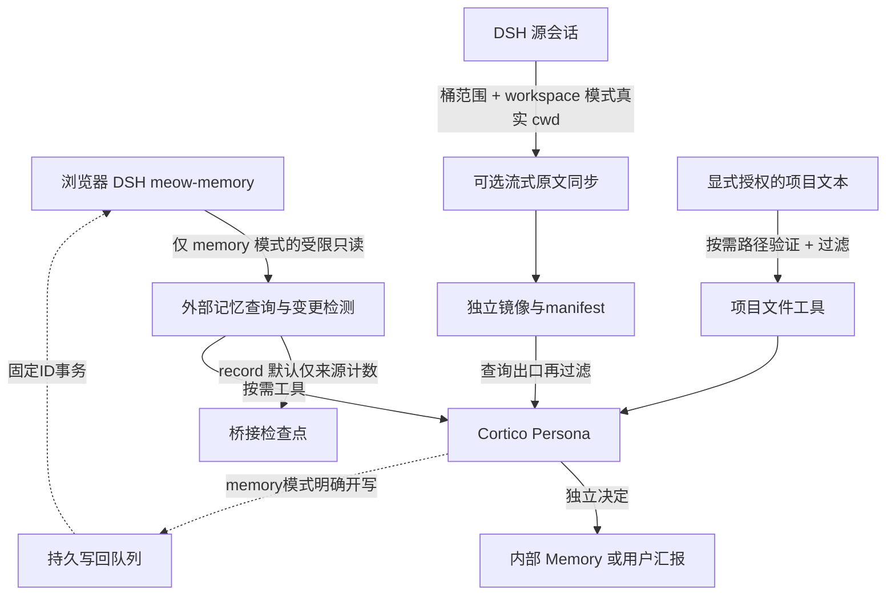
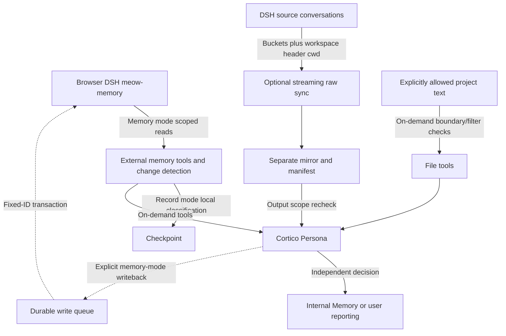

Owner: `src/world.ts` / `DshMemoryWorld`; memory access: `src/store.ts`; raw mirroring: `src/raw.ts`; project-file tools: `src/workspace.ts` / `WorkspaceFiles`.

# 🚨 安全风险 / SECURITY RISKS — 启用前必读 / READ BEFORE ENABLING

**这个 World 可以读取 DSH 记忆、未蒸馏聊天和你另外授权的项目文件，并把内容交给 Cortico 智能体。它们可能进入模型请求、宿主事件、回答和下游消息。`memory` 模式还支持显式开启的记忆写回。请先禁写、禁原文、禁项目文件，再按实际用途逐项授权小范围。**

**This World can expose DSH memories, undistilled conversations and separately authorized project files to the Cortico agent. Content may enter model requests, host events, replies and downstream messages. Memory mode also supports explicitly enabled writeback. Start with writeback, raw access and project files disabled; enable narrow capabilities separately.**

| 风险 / Risk | 实际影响与处理 / Consequence and boundary |
| --- | --- |
| 资料外泄 / Data disclosure | 蒸馏记忆、聊天原文和项目文本仍可含个人信息、代码与商业资料；审查允许范围、模型提供商、事件保留和消息接收限制。/ Memories, raw chats and project text can contain private/business data; review scopes, model providers, retention and recipients. |
| 提示注入 / Prompt injection | 聊天、记忆、README、注释中的指令都是不可信外部材料，不能授权执行、写 Memory 或反向控制。/ Imported instructions in chats, memories or files are untrusted evidence, not authority for execution, Memory changes or control. |
| 额外文件能力 / Additional file exposure | 新文件工具读取授权项目的文本资料，范围与 SQLite 项目名单不相同；过滤不是万能保密。/ File tools expose text under filesystem roots, independently of SQLite project names; filters do not guarantee confidentiality. |
| 来源声明与路径竞争 / Source assertions and path races | session头cwd是来源文件声明，不是抵御恶意篡改的可信凭证；标准Node路径检查不是原子安全沙箱。使用自己控制的可信源/项目。/ Session cwd is a source assertion, not a tamper-proof credential; Node checks are not an atomic OS sandbox. Use trusted sources/directories you control. |
| 当前文件与历史不一致 / Current files versus history | 文件工具读当前磁盘，不是聊天当时的代码快照；对照历史需明确版本和时间。/ Tools read current disk content, not the code at chat time; identify versions/times when comparing history. |
| 写回改变源数据 / Source writeback | memory 模式可向源记忆表添加持久条目；queued 不是 written，来源证据也不等于正确事实。/ Memory mode can insert persistent source entries; queued does not mean written, and provenance does not prove truth. |
| 默认值误用 / Misleading defaults | 包默认停用，但 memory 的写回与原文默认值为开；rawBuckets 空表示全部未受保护桶。/ The package is disabled by default, but memory-mode writeback/raw defaults are on; empty rawBuckets means all unprotected buckets. |
| 脱敏漏检或过度清洗 / Redaction gaps or alteration | 已知凭据形状会清洗，未知密钥或私人内容可能保留，长十六进制等可能被清洗而改变证据。/ Known patterns are scrubbed, but unknown secrets can remain and scrubbing can alter evidence. |
| 资源与格式风险 / Resource and format risk | 多帧 Zstandard 校验/重放、镜像、SQLite结构变化和项目搜索消耗资源，源升级可能不兼容。/ Frame validation/replay, mirrors, schema changes and searches consume resources; source upgrades can break compatibility. |
| 运行状态风险 / Runtime-state risk | 删检查点/manifest 可破坏去重与队列；修改范围可能拒绝旧状态；存储回执不等于模型或QQ已完成。/ Deleting state damages deduplication/queues; scope changes can reject reuse; storage receipts are not end-to-end completion. |

**源聊天只读仍会写本地镜像、检查点和审计日志。memory 模式启用写回才写源库。检查点可含待写正文；镜像和宿主事件可含聊天正文。不要上传运行目录、数据库、实际项目文件、`.env`、部署配置、token、真实日志或恢复备份。脱敏不能替代授权。**

**Read-only chat access still writes local mirrors, checkpoints and journals. Source-memory writes require enabled writeback in memory mode. Checkpoints can contain queued drafts; mirrors and events can contain chat text. Never upload runtime data, databases, actual project files, .env, deployment configuration, tokens, real logs or recovery backups. Redaction does not replace authorization.**

**启用 memory 模式前请注意：旧兼容默认值为 `writeEnabled:true` 和 `rawEnabled:true`。只想只读记忆时必须明确把两项设为 `false`；`sourceMode:workspace` 从不创建记忆库 writer，但开启 raw 后仍会在本地保存聊天镜像。**

**Before enabling memory mode: legacy defaults are `writeEnabled:true` and `rawEnabled:true`. Set both explicitly to false for memory queries only. Workspace mode never creates a memory writer, but enabled raw access still stores local conversation mirrors.**

# Cortico DSH World 0.5.0

独立仓外 World，id `dshmemory`，配置 `worlds.dshmemory`，独立工作台 `world:dshmemory`。支持 **memory**（有 DSH meow-memory SQLite）和 **workspace**（不需要记忆库的项目/会话读取）两种来源模式；两种都可单独开启按需项目文件工具。反向任务控制属于另一包，需要独立授权。

An independent external World: id `dshmemory`, configuration `worlds.dshmemory`, console `world:dshmemory`. It supports **memory** mode with DSH meow-memory SQLite and **workspace** mode for project/conversation access without a memory database. Both can opt into on-demand project-file tools. Reverse task control is a separately authorized package.

**发布状态 / Release status:** 发布说明已交付，用户已授权 GitHub 上传。本项目独立仓外交付；包保持 `private:true`，通过仓库源码或 `.tgz` 安装，未发布到 npm。测试、契约、生产挂载和 24 小时稳定性各自验收；本版本尚未完成生产挂载或 24 小时稳定性验收。/ The manual has been delivered and the user has authorized GitHub upload. This is an independent external World, installed from repository source or a `.tgz`; `private:true` prevents accidental npm publication. Tests, contract validation, production mounting and 24-hour stability are separate acceptance layers. This version has not yet completed production mounting or 24-hour stability acceptance.

[完整中文说明](#中文说明) · [Complete English manual](#english-manual)

## 中文说明

### 1. 模式怎么选

| 功能 | `sourceMode:memory`（默认） | `sourceMode:workspace` |
| --- | --- | --- |
| 必须有 meow-memory 数据库 | 是，已有兼容 SQLite，`dbFile` 绝对路径。 | 否，不构造记忆库 reader/writer。 |
| 精确来源范围 | `allowedProjects/levels/includeGlobal` 限定记忆；原文 `rawBuckets` 独立。 | `workspaceRoots/workspaceDenied` 限定真实会话头 cwd；rawBuckets 可再缩小。 |
| 记忆 search/read/remember | 提供；写入受 writeEnabled 和层/项目范围约束。 | 不提供，避免把缺库当故障或悄悄开写。 |
| 自动新记忆处理 | 默认 record，只本地计数和引用。 | 无记忆轮询/入库。 |
| 原文 mirror | rawEnabled 显式控制。 | rawEnabled 显式控制，按 session cwd 授权，出口再次过滤。 |
| 项目文本文件 | workspaceFilesEnabled 显式开，使用自己的 workspaceRoots/Denied。 | 同样显式开。 |
| 默认状态目录 | `<deployment>/data/dshmemory`。 | `<deployment>/data/dshmemory-workspace`。 |

只想让 Cortico了解一个没有安装 meow-memory 的项目，选 workspace，填写存在的具体项目目录。想查 DSH 已蒸馏的记忆，选 memory。workspace 不是自动创建数据库的替代，也不假装记忆已入库。它们都是对外部来源的访问，不自动合并 Cortico 内部 Memory，不通过 MAIL memory 中转。

### 2. 运行要求和机制

使用已在用的**浏览器插件 DSH**，不需要切到桌面 EAC 或启动额外 headless DSH。需要 **Node.js 22.15.0 或更新兼容版本**（内置 SQLite/Zstandard）与 **Cortico World API 5**。开发 SDK 和当前现场宿主基线是 Cortico 0.1.7；扩展加载器会检查实际 API 契约。未来来源/宿主升级须重新验证。

Windows 是当前现场验证平台。Unix 源码检查与路径语法不等于现场验收；DSH 原生目录/桶编码、Zstandard/JSONL版本和保护规则应在目标平台单独验证。内置保护常量包含原环境的 `F:/AI/对话备份`、`F:/AI/对话记录`，它是有限 guard，不代表识别所有私人目录，见第5节。



外部来源引用不是内部 Memory 权威，也不会自行发 QQ。模型提供商、宿主事件保存、Persona的工具权限和消息接收范围仍决定数据会到哪里。

### 3. 安装与第一次启用

1. 下载审阅过的源码或克隆已审版本。需要开发验证，在独立仓根运行：

   ```bash
   npm ci
   npm test
   npm run typecheck
   ```

2. Cortico“扩展 → World”选本机目录，指向本仓根（`package.json/src/console.js`）。这是链接安装，固定审阅副本的位置。
3. 命令行替代安装，替换所有绝对路径占位：

   ```bash
   cd <CORTICO_ROOT>/extensions
   corepack pnpm add --ignore-workspace "<ABSOLUTE_DSH_WORLD_REPO>"
   ```

   若宿主设 `CORTICO_EXTENSIONS_DIR` 则用该目录；不可省略 ignore-workspace，以免写入主仓依赖。
4. 宿主根可检查扩展契约：

   ```bash
   corepack pnpm check:extension "<ABSOLUTE_DSH_WORLD_REPO>"
   ```

   它检查构造、声明、工具和面板，不启动真实源库/同步，不代表现场验收。
5. 保持停用，选一种模式并配置下面小范围示例；显式关闭写回、原文和文件能力。核对后正常启用/重载，先看 mode/范围/读者状态，再做只读查询或小批同步。

配置为非热更新；修改后通过宿主正常生命周期重载，按宿主要求重启进程。`npm pack` 只打包包声明、源码、面板、元数据审计脚本、README、LICENSE和NOTICE，不包含测试/依赖/运行数据；打包不等于发布，private:true 防意外 npm publish。

### 4. 安全配置示例

这是现有部署的配置片段，不能整个覆盖 config。路径、项目、桶名全是占位例子。先 enabled:false，核对后再开。

**memory：先只读记忆，不镜像、不写回、不读项目文件。**

```json
{
  "worlds": {
    "dshmemory": {
      "enabled": false,
      "sourceMode": "memory",
      "dbFile": "C:/Projects/bridge-demo/.dsh-meow/memory.db",
      "allowedProjects": "bridge-demo",
      "includeGlobal": false,
      "levels": "project,fact,lesson,topic,rules",
      "watchTrigger": "record",
      "watchIntervalSeconds": 60,
      "writeEnabled": false,
      "writeLevels": "fact,topic",
      "rawEnabled": false,
      "sessionsDir": "C:/BridgeSources/dsh-sessions",
      "rawDir": "C:/BridgeState/dsh-raw",
      "rawBuckets": "EXACT_ALLOWED_BUCKET_NAME",
      "rawSyncIntervalSeconds": 0,
      "workspaceFilesEnabled": false,
      "workspaceRoots": "[]",
      "workspaceDenied": "[]",
      "workspaceMaxFileBytes": 1048576,
      "stateDir": "C:/BridgeState/dshmemory"
    }
  }
}
```

**workspace：无需 dbFile，先授具体项目根，文件/原文仍保持关闭。**

```json
{
  "worlds": {
    "dshmemory": {
      "enabled": false,
      "sourceMode": "workspace",
      "workspaceRoots": "[\"C:/Projects/bridge-demo\"]",
      "workspaceDenied": "[\"C:/Projects/bridge-demo/private\"]",
      "workspaceFilesEnabled": false,
      "workspaceMaxFileBytes": 1048576,
      "writeEnabled": false,
      "rawEnabled": false,
      "sessionsDir": "C:/BridgeSources/dsh-sessions",
      "rawBuckets": "EXACT_ALLOWED_BUCKET_NAME",
      "rawSyncIntervalSeconds": 0,
      "rawDir": "C:/BridgeState/dshmemory-workspace/raw-v2",
      "stateDir": "C:/BridgeState/dshmemory-workspace"
    }
  }
}
```

memory 模式数据库必须已存在且具备兼容表/列，桥接不创建或迁移。出厂 enabled:false 之外，**memory 的 writeEnabled 和 rawEnabled 默认是 true**，不要只填库路径就开启总开关。sourceMode=workspace 即使遗留 memory 配置字段也不启用记忆writer/轮询；删库不是切换模式的方法。

raw启用时 sessionsDir 必须是存在的真实会话目录；空默认 `~/.dsh/sessions`。workspace 默认镜像是状态目录内 `raw-v2`；memory 的 rawDir 空时沿用数据库同级 raw。填写独立目录便于审计和保留；不要把状态或镜像放在授权项目根内。示例不建议复制项目文件到发布仓。

### 5. 如何划定范围

**memory范围：** allowedProjects 是半角逗号分隔、1–100个精确项目名，不是文件路径或前缀。库中条目的项目成员按逗号拆分后精确匹配。levels限定层，只读active；includeGlobal=false排除空/global/全局成员及soul/user层。开global仍要把要读全局层列入levels。全局扩大隐私，不建议为排查问题随便开启。

**原文桶范围：** rawBuckets 为完整源桶名半角逗号列表，DSH自己决定编码。不要猜路径片段。**空表示全部未受保护桶，不表示关闭。** 用 rawEnabled=false关闭；工具只能缩小此范围。memory 的 allowedProjects 不限制原文桶；rawBuckets 不限制库项目。

**workspace范围：** workspaceRoots/workspaceDenied 是**包含绝对路径JSON数组的字符串**；允许根目录必须存在。授权包括子目录，deny优先并检查真实路径；选择实际小项目根，避免全盘/HOME，文件能力开启时明确拒绝这类宽根。raw sync依赖源会话头cwd授权，不能只靠桶名相似；镜像记录来源cwd，read/search出口再次核对。rawBuckets可以额外收窄，不可绕开cwd授权。

为了确定cwd，可能枚举并读取候选会话头元数据；不要理解为完全不接触其他目录元数据。受保护桶先排除，越授权的聊天正文不导出。header cwd是DSH源文件的来源声明，不能防止有权篡改源文件的人伪造归属；选择可信的源目录与项目，不把这项过滤说成安全沙箱。

旧镜像中没有 sourceCwd 的记录不能通过 workspace 出口导出；不要补猜的cwd，也不要把旧manifest删除后重新全量导入。模式/范围改变后使用独立状态绑定；来源目录、root/deny和mode是持久边界。

memory 模式要开文件，也必须填workspaceRoots/Denied；allowedProjects 不会自动生成文件根。**memory模式显式填写非空workspaceRoots时，原文通道也会额外按这些根做cwd过滤**，需连同rawBuckets一起审查。文件工具要求root是精确配置根，path在该根内相对；每次校验逻辑/realpath/deny/身份，拒绝symlink/junction/hardlink与设备名/ADS和越界，根被替换报SOURCE_CHANGED。

内置保护包含 `F:/AI/对话备份`、`F:/AI/对话记录`、对应编码桶及真实路径越界/会话头检查。这是原环境有限保护，**不识别所有备份、私密项目或普通名称内的敏感文件**。DSH raw没有通用deniedBuckets；使用精确raw允许列表。实现见 [src/config.ts](src/config.ts)、[src/raw.ts](src/raw.ts)、[src/world.ts](src/world.ts) 和 [src/runtime.ts](src/runtime.ts)。

Unix路径JSON语法使用 `/srv/projects/bridge-demo`、`/srv/projects/bridge-demo/private` 等绝对路径；仅语法说明。目标平台保护常量/源目录、DSH格式和挂载仍需验收，不能把本次Windows结果当Unix通过。

### 6. 项目文件：按需的第三条读取路径

workspaceFilesEnabled 默认 false；它不依赖库，不自动扫描所有项目，不执行、不写文件、不自动推送正文。使用root/deny最小授权，切换开关后正常重载。单文件workspaceMaxFileBytes默认1MiB，允许配置1024–8MiB；大于上限明确拒绝，另有输出/扫描预算和分页。

文件有效deny包括用户workspaceDenied及sessionsDir/stateDir/rawDir的配置与真实路径，status.files.denied可查看；自定义改名的源/镜像/运行目录同样屏蔽。

它读取**当前磁盘内容**，不能当作源聊天当时的快照。Node的logical/realpath/lstat/fstat前后检查能拒绝许多路径变化，但不是操作系统能力级原子沙箱，不保证抵御恶意并发目录交换。只选自己控制的可信目录。

默认排除凭据、隐藏、git、依赖、构建、二进制、数据库、日志、归档和私钥等；这减少无关或高风险来源，不保证其他文本安全。已知密钥形状会清洗，但项目源码、业务信息和注释仍可能送模型。安全范围须在文件工具启用前审查。

仅接受文本allowlist中的有效UTF-8文件；NUL、非法UTF-8和识别出的私钥正文拒绝。启用顺序是先核对roots/deny，再改workspaceFilesEnabled=true保存重载，先list根目录`.`、read公开README，确认来源/分页后再search；撤销时关闭并重载，过去已读资料不会撤回。

| 工具 | 调用例子与续页 |
| --- | --- |
| dshmemory_files_list | `{"root":"C:/Projects/bridge-demo","path":".","limit":20}`；仅直接子项，nextCursor作为下页cursor。 |
| dshmemory_file_read | `{"root":"C:/Projects/bridge-demo","path":"README.md","offset":0,"maxChars":12000}`；nextOffset是**脱敏后文本UTF-16字符位置**，version是原文件SHA256，多页核对版本。 |
| dshmemory_files_search | `{"root":"C:/Projects/bridge-demo","path":".","query":"initialize","limit":20}`；递归且区分大小写字面搜索，每匹配文件首个节选，用nextCursor续页。 |

未知参数拒绝。list/search cursor是**进程内实时遍历令牌**，5分钟有效/单次消费/最多16个活动令牌；过期、重复使用、停止/重启需重发原请求，不是永久偏移/快照。read每页重读有界文件；version变化就停止拼接、重新读。

固定限制：每页最多检查512目录项，list最多100条，search最多32文件或8MiB实际读取/20命中，read最多32,000字符，待遍历目录最多1024，超额报告覆盖不足。truncated/incompleteReasons/skipped与coverage表示仅合格文本allowlist；跳过/EXCLUDED或无命中不证明全项目没有内容。

### 7. 记忆和原文工具

| 工具 | 可用模式与语义 |
| --- | --- |
| dshmemory_status | 两模式；mode、启用能力、健康、来源、队列、最近错误。 |
| dshmemory_search | memory；query/project必需，level/limit可选；字面子串/关键词匹配，外部来源，非向量召回。 |
| dshmemory_read | memory；完整id/level/project，正文最多32,000字符，检查truncated。 |
| dshmemory_remember | memory且writeEnabled；level/project/content/keywords必需；queued/written分别解释。 |
| dshmemory_raw_sync | rawEnabled；buckets/maxTurns只缩范围，写独立镜像，源聊天只读。 |
| dshmemory_raw_search | rawEnabled；query与可选精确bucket，来源桶/日期/行/角色。 |
| dshmemory_raw_read | rawEnabled；bucket/day，win/offset/limit；offset是镜像分页位置，不是压缩源字节游标。 |

workspace没有记忆读写工具。memory禁写时记忆写工具声明仍可能显示但调用拒绝；raw三个工具随开关。工具数量必须结合模式/配置。read返回not_found或空search只是该范围本次查询，不证明全部来源不存在；截断/旧来源不可导出/批次追赶都影响覆盖。

### 8. 变更记录与 token

memory默认每60秒观察新记忆，watchTrigger=record。它只按sourceSession/project记录层级计数、更新时间和最近20个引用，不调用Core，也不把“新记忆”当工作完成；来源为空保持为空。新记忆入库不会每次唤醒模型。

首次memory启动建立当前库基线，重启恢复updatedAt/level/id持久全序游标；同毫秒重叠去重。源必须更新updated_at，改写更早时间不保证自动通知，可按需查询。flush/debounce/piggyback是投递正文的兼容方式，会影响模型触发，不应为了记录而开启。

workspace不运行记忆轮询。项目文件只在工具请求时访问。原文定时同步是本地镜像操作，与是否推模型分开。Persona独立决定读多少、是否写内部Memory/汇报；本包不能替代模型费用上限。

### 9. 大帧同步与写回回执

DSH原文是追加式多帧Zstandard。先完整流式校验帧，再逐行提取公开消息；raw-v2用稳定itemId去重，按桶/日期追加，manifest持久帧/行游标及帧SHA256。合法帧**解压总量超过64MiB仍可分批推进**，不再整体分配超大Buffer。

开启原文前确认真实sessionsDir、独立rawDir及精确rawBuckets（workspace另核对roots/deny）。先rawEnabled=true且rawSyncIntervalSeconds=0，保存重载后用raw_sync的较小maxTurns做一批；核对来源、去重、帧行推进后再考虑正数自动间隔。默认每批rawMaxTurns=2000、自动间隔60秒；这些默认不是要求首批全部导入。

不同限制不能混为一个：默认压缩校验输入64MiB/新处理JSONL64MiB预算，解码窗口64MiB，单事件2MiB，读取输出4MiB。压缩帧超预算、窗口太大或单JSONL太长会明确拒绝；不自动无限放大。帧内恢复重放旧行，旧重放不计新处理预算，但真实CPU/I/O增加。

监测scannedBytes/decodedBytes、validationDecodedBytes、processingReadBytes、replayedDecodedBytes、headerReadBytes；比较新字节、manifest帧行和原文总数。大重放伴随新进度是正常追赶可能；游标一直不动且错误重复才需进一步修。半帧等源补齐，完整坏JSON/UTF8/身份变化报错保留游标。

memory写回先固定ID持久队列，再定时或flush:true事务写源。**queued:true只表示队列保存；written:true或同ID写回回执才代表入库。** 默认队列冲刷15秒、每轮20条、pending1000；项目和writeLevels必须在配置范围，writeLevels为levels子集，禁止soul/user。禁写后旧队列保留；不要换新ID重投未知写入。

仅在独立测试库验证后启用写回，审查内容与关键词，不让外部提示注入/猜测事实自动入库。workspace绝不创建writer，即使memory遗留writeEnabled=true。

### 10. 日志监测与验收

工作台区分mode与能力，观察最近成功、当前错误和增量。健康空闲、分批追赶、禁用、无生产样本和故障分别解释。memory读库健康默认15秒；写空队列在线但可能无写入样本。workspace不需要给不存在的数据库显示故障。

checkpoint和每日audit日志是桥接自有运行资料，checkpoint可能含待写正文，镜像含公开聊天。审计脚本读取恢复文件与metadata日志，按 sourceMode 分别检查 reader 或 workspace 心跳，报告省略正文，不遍历源桶或项目文件。mode默认state不同，审计参数必须指正在运行的对应目录：

```bash
npm run audit -- --data "<ABSOLUTE_DATA>/dshmemory" --hours 24 --out "<ABSOLUTE_PRIVATE_REPORTS>/dsh-memory-audit.json"
npm run audit -- --data "<ABSOLUTE_DATA>/dshmemory-workspace" --hours 24 --out "<ABSOLUTE_PRIVATE_REPORTS>/dsh-workspace-audit.json"
```

--hours24只是窗口请求，按新版实际挂载时刻计算观察时长；不足24小时明确标观察不足。没有错误/测试多/空闲心跳多不能独立宣布稳定。核对真实生产读取、原文进度、待处理队列与回执；无写回样本不能说写回通过。宿主事件确认不等于QQ发送；QQ原生崩溃、账号和OneBot端口另外检查。

### 11. 故障怎么修

| 故障 | 核查与安全恢复 |
| --- | --- |
| 灯红或查不到记忆 | sourceMode、db路径、兼容表、精确project/layers、当前错误；保存状态，修正范围/权限，不改成全盘。 |
| workspace无memory工具 | 正常模式边界；需要库查询应按明确切换方案选memory，不临时创建空库骗过健康检查。 |
| 文件工具拒绝 | 看开关、roots存在、具体项目根、deny/链接/隐藏/大小；默认过滤不是建议你关闭认证或放大授权。 |
| 查不到会话原文 | 完整rawBucket、真实header cwd、sourceCwd、raw开关和批次覆盖；旧镜像无cwd不可workspace导出，不补猜来源。 |
| >64MiB出现ERR_BUFFER_TOO_LARGE | 实际已加载流式版、帧offset、压缩量、新/重放字节；保留manifest续批。压缩预算/窗口/单行限制分别评估。 |
| 坏完整JSON/UTF8或身份变化 | 保留位置和源证据；在副本验证修复，不跳过/编辑源。半行或半帧等补齐。 |
| 原文停滞或同步锁长期占用 | 在途Worker/错误、帧行、新处理/重放、磁盘与源变化；有界操作等结束，确认故障后正常停用/优雅重载，不手删锁/manifest、不并发强同步。 |
| scope mismatch或mode切换错误 | 原配置、原mode、queue/outbox；恢复旧配置对账，独立新state迁移，不删checkpoint/队列。 |
| 只记录没有通知 | record预期；按需工具查询。记忆插入不表示原任务完成；不要为了推送而伪造终态。 |
| token消耗多 | 看flush/debounce/piggyback与宿主其他触发；回record，项目files只按需，不自动扫描仓。 |
| pending写回失败/结果未知 | 同ID回执、attempts、write开关、源锁/列；恢复正常访问继续原队列，不用新ID重发。 |
| 升级仍旧UI | 实际包哈希/版本、宿主加载时间、缓存；console.js变化提高版本，正常重载再刷新。 |
| QQ说报错但本World正常 | 检查Persona原报错、QQ客户端、端口/账号/协议回执，不能从记忆灯判断整条消息链。 |

### 12. 停用、模式/范围迁移和回滚

正常停World，等待在途读取/写回/Worker退出，备份配置、检查点、日志、镜像和manifest。关写回或原文不会清旧队列或源绑定；卸包不删除已入库记忆、镜像或宿主事件。

sourceMode默认使用不同state目录；memory与workspace不能显式混用旧检查点。改source/roots/deny/projects/layers等可能scope拒绝，先恢复原配置对账outbox/queue；需要新范围时明确归档和处理旧未确认工作，再独立state建立基线。不手改hash、不盲删manifest或数据库。

回滚前检查旧代码理解当前checkpoint/镜像版本。保留已验证包和清单；不兼容就停止制定迁移。停用不能撤回已送模型资料；删除敏感镜像/事件需按各系统保留与删除流程单独处理。

### 13. 开发、发布和问题报告

源码/tests/docs/lockfile/占位示例可发布，真实资料和运行状态不能混入。npm检查、宿主契约与现场样本分层验收。问题报告提供mode、版本、Node/宿主、开关、人工审查的范围形状、错误码、游标进展与合成复现；不要贴源内容、真实路径/QQ号/token/完整checkpoint，UUID也可一致替换。

本项目按Cortico仓外扩展发布，主库issue可以说明安装、风险与契约证据，不承诺内置或自动控制。用户审阅README后才GitHub上传。控制能力是另一包，需独立认证、确认和原生权限，不由项目文件或记忆来源授予。

## English manual

### 1. Choosing a mode

| Feature | sourceMode:memory (default) | sourceMode:workspace |
| --- | --- | --- |
| meow-memory database required | Existing compatible SQLite at an absolute dbFile. | No database reader/writer is constructed. |
| Scope | Exact allowedProjects/layers/global for memories; independent rawBuckets. | Workspace roots/deny check actual session-header cwd; buckets can narrow further. |
| Memory search/read/remember | Available; writes require enabled scoped writeback. | Not provided. |
| Automatic memory changes | Record-only classification by default. | No memory polling or insertion. |
| Raw mirror | Explicit rawEnabled. | Explicit rawEnabled, source cwd authorization and output rechecking. |
| Text project files | Separate opt-in and workspace roots/deny. | Same explicit opt-in. |
| Default state | deployment data/dshmemory. | deployment data/dshmemory-workspace. |

Choose workspace to access a project without meow-memory, using an existing specific directory. Choose memory for distilled DSH memories. Workspace does not create a database or claim memory ingestion. Both expose external sources without automatically merging Cortico internal Memory or relaying through MAIL memory.

### 2. Requirements and data flow

Use the existing **browser-plugin DSH** environment; desktop EAC or an extra headless DSH instance is unnecessary. Requirements are **Node.js 22.15.0 or a newer compatible version** for built-in SQLite/Zstandard and **Cortico World API 5**. The SDK/current host-validation baseline is 0.1.7; the loader checks actual contracts. Revalidate source/host upgrades.

Windows is the current live-validation platform. Unix syntax/source checks are not target-platform acceptance. Validate native paths/bucket encoding, JSONL/Zstandard formats and protection on that platform. The environment-specific built-in protection includes F:/AI/对话备份; it is limited rather than a universal private-directory detector.



External provenance is not internal Memory authority or permission to send QQ. Providers, event retention, Persona tools and recipient boundaries govern later processing.

### 3. Install and start safely

1. Obtain reviewed source/version. For development validation in this independent repository root:

   ```bash
   npm ci
   npm test
   npm run typecheck
   ```

2. In Cortico Extensions → World, select this repository root containing package.json/src/console.js. Local installation is linked; keep the reviewed directory fixed.
3. Alternative command-line installation:

   ```bash
   cd <CORTICO_ROOT>/extensions
   corepack pnpm add --ignore-workspace "<ABSOLUTE_DSH_WORLD_REPO>"
   ```

   Use CORTICO_EXTENSIONS_DIR if set. Preserve ignore-workspace to keep deployment dependencies out of the main repository workspace.
4. Optional contract check in the host root:

   ```bash
   corepack pnpm check:extension "<ABSOLUTE_DSH_WORLD_REPO>"
   ```

   It checks construction/declarations/tools/panels, not live source reads or sync.
5. Choose one mode while disabled and use narrow examples below. Explicitly turn writeback/raw/files off first. Enable/reload normally, inspect mode/scope/health, then query or run a small authorized sync.

Configuration is not hot-reloadable. Use the host lifecycle and restart where required. npm pack includes the manifest, source, console, metadata audit script, README, LICENSE and NOTICE, excluding tests, dependencies and runtime data. Packaging is not publishing; private:true prevents accidental npm release.

### 4. Safe configuration examples

Merge fragments into the existing deployment; do not replace everything. Paths/projects/bucket names are examples. Start disabled.

**Memory: read memories first, without writes, raw or files.**

```json
{
  "worlds": {
    "dshmemory": {
      "enabled": false,
      "sourceMode": "memory",
      "dbFile": "C:/Projects/bridge-demo/.dsh-meow/memory.db",
      "allowedProjects": "bridge-demo",
      "includeGlobal": false,
      "levels": "project,fact,lesson,topic,rules",
      "watchTrigger": "record",
      "watchIntervalSeconds": 60,
      "writeEnabled": false,
      "writeLevels": "fact,topic",
      "rawEnabled": false,
      "sessionsDir": "C:/BridgeSources/dsh-sessions",
      "rawDir": "C:/BridgeState/dsh-raw",
      "rawBuckets": "EXACT_ALLOWED_BUCKET_NAME",
      "rawSyncIntervalSeconds": 0,
      "workspaceFilesEnabled": false,
      "workspaceRoots": "[]",
      "workspaceDenied": "[]",
      "workspaceMaxFileBytes": 1048576,
      "stateDir": "C:/BridgeState/dshmemory"
    }
  }
}
```

**Workspace: no dbFile, specific existing root, raw/files still off.**

```json
{
  "worlds": {
    "dshmemory": {
      "enabled": false,
      "sourceMode": "workspace",
      "workspaceRoots": "[\"C:/Projects/bridge-demo\"]",
      "workspaceDenied": "[\"C:/Projects/bridge-demo/private\"]",
      "workspaceFilesEnabled": false,
      "workspaceMaxFileBytes": 1048576,
      "writeEnabled": false,
      "rawEnabled": false,
      "sessionsDir": "C:/BridgeSources/dsh-sessions",
      "rawBuckets": "EXACT_ALLOWED_BUCKET_NAME",
      "rawSyncIntervalSeconds": 0,
      "rawDir": "C:/BridgeState/dshmemory-workspace/raw-v2",
      "stateDir": "C:/BridgeState/dshmemory-workspace"
    }
  }
}
```

Memory requires existing compatible tables/columns; the bridge does not create/migrate source SQLite. Although disabled by default, **memory writeEnabled/rawEnabled default to true**; explicitly disable them before first activation. Workspace never constructs the writer or memory poller even with legacy memory fields present. Deleting a database is not a mode switch.

Raw access requires an existing actual session directory; empty sessionsDir defaults to ~/.dsh/sessions. Workspace's default mirror is state/raw-v2; memory's empty rawDir uses database-sibling raw. Select separate directories. State/mirrors must stay outside authorized project roots; examples do not invite copying actual projects into this release.

### 5. Defining precise scopes

**Memory:** allowedProjects is 1–100 exact comma-separated project names, not paths/prefixes. Comma-separated memberships in rows match exactly. levels controls layers, active rows only. includeGlobal:false excludes empty/global/全局 and soul/user. Global access also requires the layer in levels and should not be enabled merely for troubleshooting.

**Raw buckets:** use full source directory names separated by commas; DSH defines encoding. Empty means all unprotected buckets, not disabled. rawEnabled:false disables the capability; tools only narrow. Memory allowedProjects does not constrain raw and rawBuckets does not constrain SQLite projects.

**Workspace:** workspaceRoots/workspaceDenied are strings containing absolute-path JSON arrays. Allowed directories must exist; descendants qualify and deny wins, including real paths. Use small roots, not drives/HOME. Sync checks actual session-header cwd rather than bucket similarity. Mirrors retain sourceCwd and read/search rechecks current scope; bucket selection narrows further.

Candidate conversation headers may be enumerated/read to establish cwd. This is not a promise that other directory metadata is untouched. Protected buckets are excluded first and out-of-scope chat text is not exported. Header cwd is a source assertion, not a tamper-proof credential against a malicious source writer; use trusted sources/projects.

Old mirror entries without sourceCwd cannot be exported in workspace mode. Never guess cwd or clear the manifest to reimport. Mode/source/root/deny form a persistent binding. Memory-mode files need workspaceRoots/Denied; database projects do not generate filesystem authority. Nonempty memory-mode workspaceRoots also constrain raw cwd, so review them together with buckets. Tools check exact root/relative path, logical/realpath/deny/identities, refuse symlinks/junctions/hardlinks/device/ADS/traversal and report SOURCE_CHANGED on root replacement.

Built-in protection includes F:/AI/对话备份, corresponding encoded buckets and canonical escape/header checks. It does not detect every backup/private project or secrets under ordinary names. There is no general raw deniedBuckets setting; use an exact allowlist. See [src/config.ts](src/config.ts), [src/raw.ts](src/raw.ts), [src/world.ts](src/world.ts), [src/runtime.ts](src/runtime.ts).

Unix arrays use absolute paths such as /srv/projects/bridge-demo and /srv/projects/bridge-demo/private. This illustrates syntax only; target guard/source formats and mounting require acceptance beyond this Windows run.

### 6. On-demand project files

workspaceFilesEnabled defaults to false. Files do not need a database, do not scan everything automatically, execute/write or push text. Use minimal root/deny, then reload normally. workspaceMaxFileBytes defaults to 1 MiB, configurable from 1,024 to 8 MiB; oversized files fail, with further output/scan budgets and paging.

Effective exclusions include user workspaceDenied plus configured/real sessionsDir, stateDir and rawDir. Inspect status.files.denied; renaming source/mirror/runtime directories does not authorize file reads.

Files are current disk content, not the code at conversation time. Standard Node before/after logical/realpath/lstat/fstat checks are not an atomic OS sandbox and do not establish resistance to malicious concurrent directory swaps. Use trusted directories you control.

Credential, hidden, git, dependency, build, binary, database, log, archive and private-key forms are excluded. Other text can still be sensitive. Recognized credentials are scrubbed, but source/business text/comments can reach models. Review scope before opting in.

Only allowlisted valid UTF-8 text is eligible; NUL-containing/invalid UTF-8 files and recognized private-key bodies fail. Verify roots/deny, enable files and save/reload, then list the root dot directory and read a public README before searching. Disable/reload to revoke later access; already processed content cannot be retracted.

| Tool | Example and continuation |
| --- | --- |
| dshmemory_files_list | `{"root":"C:/Projects/bridge-demo","path":".","limit":20}`; direct children; nextCursor becomes next request cursor. |
| dshmemory_file_read | `{"root":"C:/Projects/bridge-demo","path":"README.md","offset":0,"maxChars":12000}`; nextOffset is **scrubbed UTF-16 characters**, version is original-file SHA256; compare across pages. |
| dshmemory_files_search | `{"root":"C:/Projects/bridge-demo","path":".","query":"initialize","limit":20}`; recursive case-sensitive literal search, first excerpt per matching file, nextCursor continues. |

Unknown parameters fail. Live in-process list/search tokens expire after five minutes, are consumed once and are limited to16 active cursors. Expiry/reuse/stop/restart requires a new traversal, not snapshot continuation. Read pages reload the bounded file; changed version means start again rather than combining versions.

Fixed limits: 512 directory entries inspected per page, 100 list results, search of 32 files or 8 MiB actual reads with 20 matches per page, 32,000 read characters and 1,024 pending directories. Extra directory work reports incomplete coverage. Inspect truncated/incompleteReasons/skipped/coverage. Eligible-text-only output, skipped/excluded and no-match are not full-project absence claims.

### 7. Memory and raw tools

| Tool | Availability and meaning |
| --- | --- |
| dshmemory_status | Both modes: capabilities, mode, source, health, queues/errors. |
| dshmemory_search | Memory: required query/project, optional level/limit; literal substring/keywords, external provenance, no vector search. |
| dshmemory_read | Memory: full id/level/project, up to 32,000 characters, inspect truncated. |
| dshmemory_remember | Memory with enabled writes; required level/project/content/keywords; distinguish queued and written. |
| dshmemory_raw_sync | Raw enabled: buckets/maxTurns narrow; writes the mirror while source chats stay read-only. |
| dshmemory_raw_search | Raw enabled: query and optional exact bucket; provenance/date/line/role. |
| dshmemory_raw_read | Raw enabled: bucket/day, optional win/offset/limit; mirror-page offset, not compressed source byte position. |

Workspace omits memory tools. Memory write tool declaration may remain visible while disabled, but writes fail; raw tools depend on opt-in. Counts depend on mode/configuration. Empty results reflect requested scope/coverage, not absence across all sources.

### 8. Change recording and token use

Memory watches default to every 60 seconds with record. It stores sourceSession/project counts, layer counts, times and the last 20 references without waking Core. A memory insert is not task completion. Missing source remains unknown. New ingestion does not cause a model request every poll.

First start establishes a current database baseline. Restarts retain ordered updatedAt/level/id cursors; overlapping same-millisecond scans deduplicate. Source updated_at must advance; older timestamp rewrites do not guarantee notifications and can be queried on demand. flush/debounce/piggyback deliver text with corresponding Core behavior and can cost tokens.

Workspace has no memory poll. File access is on demand. Local raw synchronization and model delivery are different stages. Persona decides reads/Memory/reporting; the package is not a model spending cap.

### 9. Large-frame processing and write receipts

DSH logs are append-only multi-frame Zstandard. Validate complete frames before extracting public messages. raw-v2 deduplicates stable item IDs, appends by bucket/day and persists frame/line cursor plus SHA256. Valid total decompressed output above 64 MiB can advance in bounded batches without a giant Buffer.

Before enabling raw, verify actual sessionsDir, separate rawDir and exact buckets (plus workspace roots/deny). Start with rawEnabled:true and rawSyncIntervalSeconds:0, save/reload and request a small maxTurns batch. Check provenance/deduplication and frame/line progression before automatic intervals. Defaults are 2,000 turns per batch and a 60-second interval, not an obligation to import all old data at once.

Distinct limits remain: default 64 MiB compressed-validation and new-JSONL processing targets, a 64 MiB decoding window, a 2 MiB individual event and 4 MiB read output. Oversized compressed frames/windows/lines fail explicitly rather than expanding without bound. In-frame recovery replays old lines outside the new-processing budget, adding actual CPU/I/O.

Compare scanned/decoded, validationDecodedBytes, processingReadBytes, replayedDecodedBytes and headerReadBytes with manifest positions and raw counts. Replay plus new progress can be ordinary catch-up; no movement plus repeated errors needs diagnosis. Incomplete frames wait; complete bad JSON/UTF8 or changed source identity preserves cursors.

Memory writes persist a fixed-ID queue before timed/flush:true source transactions. Queued means local persistence only; written or the same-ID receipt proves insertion. Defaults are a 15-second flush, 20 writes per tick and 1,000 pending items. Projects and write layers are scoped; writeLevels must be a levels subset, no soul/user. Disabling keeps old accepted queue items; never retry uncertain insertion with a new ID. Validate on an isolated database first, review content/keywords and keep injection/guesses out of memory. Workspace never constructs a writer.

### 10. Logs and acceptance

Inspect mode/capabilities, recent success, current errors and increments. Distinguish healthy idle, catch-up, disabled, no production sample and failure. Memory health defaults to 15 seconds; an empty healthy writer may have no write sample. Workspace does not treat an absent database as reader failure.

Checkpoints/journals are private bridge data; checkpoints can contain queued drafts, mirrors contain text. Audit reads bridge recovery/metadata and omits bodies in reports, not source buckets or project files. Select the actual mode's data:

```bash
npm run audit -- --data "<ABSOLUTE_DATA>/dshmemory" --hours 24 --out "<ABSOLUTE_PRIVATE_REPORTS>/dsh-memory-audit.json"
npm run audit -- --data "<ABSOLUTE_DATA>/dshmemory-workspace" --hours 24 --out "<ABSOLUTE_PRIVATE_REPORTS>/dsh-workspace-audit.json"
```

--hours 24 requests a window; calculate observed duration from actual new-version mounting. Less than 24 hours is insufficient observation. Clean logs/many tests/idle heartbeats alone do not prove stability. Reconcile production reads, raw progression, queues and receipts; unsampled writes remain unverified. Host events do not prove QQ sends. Native QQ crashes, account/port/OneBot issues are separate.

### 11. Troubleshooting

| Problem | Safe diagnosis and recovery |
| --- | --- |
| Red or missing memory | Mode, database/schema, exact project/layers/current error; preserve state and fix minimal access. |
| Workspace lacks memory tools | Intended boundary; switch through a reviewed migration rather than creating an empty database to simulate health. |
| File refusal | Opt-in, existing small roots, deny/links/hidden/size; preserve the boundary rather than broaden scope. |
| Missing raw conversations | Full bucket, real header cwd/sourceCwd, switch and coverage; old no-cwd entries cannot export in workspace. |
| ERR_BUFFER_TOO_LARGE above 64 MiB | Actually loaded streaming code, frame position/input and new/replay bytes; preserve manifest and resume batches; assess each remaining limit separately. |
| Bad complete JSON/UTF8 or changed identity | Preserve source/cursor, verify repair on a copy, no skips/edits; wait for partial completion. |
| Stalled/locked sync | In-flight Worker/errors, frame/line, new/replay work, disk/source changes; finish bounded work or stop/reload gracefully, no lock/manifest deletion/concurrent forced sync. |
| Scope/mode mismatch | Restore original configuration, reconcile queue/outbox then explicit separate state; do not clear checkpoints. |
| Recorded but no notification | Expected record mode; query on demand; ingestion is not native task completion. |
| Excess tokens | Check delivery triggers/other host behavior; record and on-demand files avoid automatic text pushes. |
| Pending/unknown writes | Original ID/receipt/attempts/source access; continue same queue after repair, not new-ID resend. |
| Old UI after update | Loaded bytes/version/start time; bump console package version, normal reload/refresh. |
| QQ reports an error with healthy World | Persona error, native QQ/transport/account/receipts independently, not inferred from a memory lamp. |

### 12. Disablement, mode/scope migration and rollback

Stop normally and wait for reads/writes/Workers. Back up settings/checkpoints/journals/mirror/manifest. Disabling write/raw retains queue/source binding; removing code does not erase source memories, mirrors or host events.

Modes default to separate state directories and cannot explicitly reuse incompatible checkpoints. Source/root/deny/project/layer changes can reject scope. Restore original scope to reconcile outstanding work; choose new state only after an explicit archive/queue decision. Do not edit hashes or delete manifests/databases blindly.

Check old code supports current checkpoint/mirror schemas before rollback. Preserve previous package/manifests; incompatible recovery needs planned migration. Disablement cannot retract model-processed data; sensitive mirrors/events need separate retention/deletion procedures.

### 13. Development, issues and publishing

Publish allowlisted source/tests/docs/lockfiles/placeholders, never live data. Repository tests, host contracts and live samples are separate. Issues include mode/version/Node/host/switches/portable scopes/error codes/cursor progression and synthetic reproduction, not chats/real paths/QQ IDs/secrets/full checkpoints; use consistent UUID placeholders too.

This is an external Cortico extension. A main-repository issue can document installation, risks and contract evidence; it does not promise built-in status or automatic task control. GitHub publication follows user README review. Reverse control needs another package with independent authentication, confirmation and native permissions.
